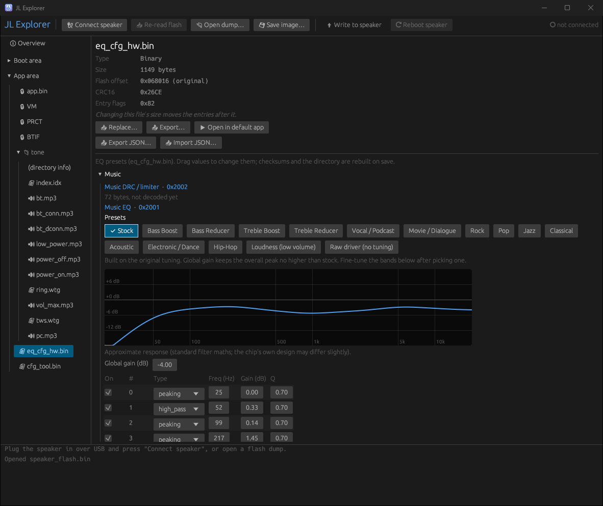
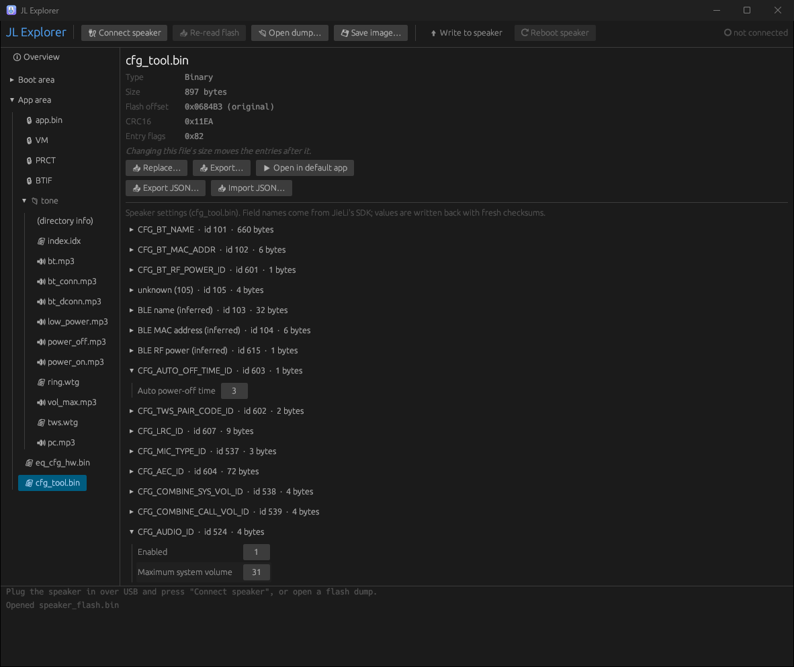
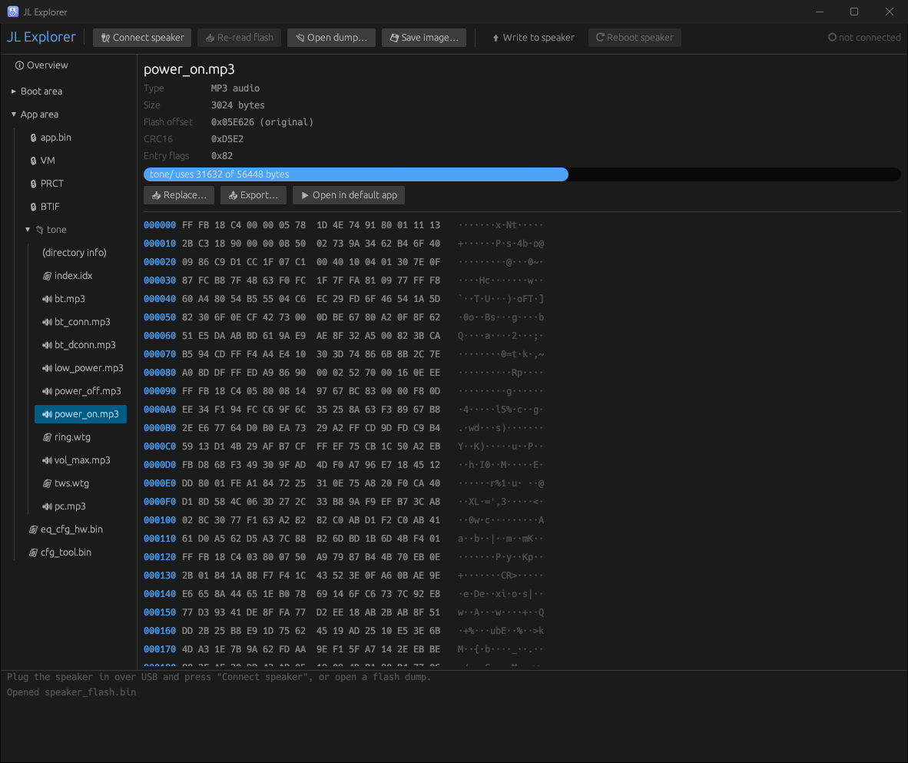

# JL Explorer

Desktop tool for speakers built on the JieLi **BR25** chip family (AC696N / AC636N / AC608N).
It connects over USB, reads the whole flash, lets you browse and
replace firmware files (e.g. the voice prompts in `tone/`), and writes back only what changed.

Tested on one device so far: a Philips SPA3709 USB speaker. Other BR25 speakers should work,
but their files may differ.

## Screenshots



<p>
  
  
</p>

## Features

- Connect over USB: switches the speaker into the Boot ROM download mode, uploads the flash
  loader and reads the full flash. Every read is backed up to `Documents/jl-explorer-backups/`.
- Open a saved flash dump (`.bin`) without a speaker attached. The chip key is recovered
  automatically.
- Browse the boot area, app area (`app.bin`, reserved areas) and resources (`tone/`, config, EQ).
- Hex view, export, open in the default app (e.g. play an MP3), and replace or revert files.
- Rebuild: re-lays out the app area, fixes every CRC and re-encrypts with the chip key.
  Directories keep their size when the new files fit, so nothing else in flash moves.
- Write to speaker: erases and rewrites only the 4K sectors that differ, verifies each one,
  then re-reads the flash. Writes outside the app area (bootloader, settings) are blocked
  unless you explicitly allow them, e.g. to restore a full backup.

## Decoded files

| File | What it holds | Editing |
|---|---|---|
| `cfg_tool.bin` | Bluetooth/BLE names and MACs, volumes (max, power-on, prompt), auto-off time, RF power, key mapping, prompt/LED mapping, mic and charge settings | GUI editor + JSON |
| `eq_cfg_hw.bin` | EQ presets per mode (music, call down/uplink): filter type, frequency, gain, Q, on/off per band; DRC blocks kept as hex | GUI editor + JSON |
| `isd_config.ini` | Encoded chip key and boot/download settings | read-only |

Item IDs and layouts come from JieLi's public SDK (`syscfg_id.h`, `user_cfg.h`, `hw_eq.h`).

### EQ presets

The music EQ editor has 16 presets (Bass/Treble Boost and Reducer, Vocal, Movie, Rock, Pop,
Jazz, Classical, Acoustic, Electronic, Hip-Hop, Loudness, Stock, Raw). They are applied on
top of the speaker's original tuning and follow these rules:
- the high-pass filter stays on
- nothing is boosted below ~100 Hz
- no band offset is larger than +3 dB
- the global gain keeps the overall peak no higher than the stock tuning's

The response curve under each EQ table uses standard biquad maths, so it's approximate.

### jlcfg (command line)

```
jlcfg unpack    <flash.bin> <dir>            extract all files (boot/, app/, app/tone/)
jlcfg decompile <file.bin> [out.json]        cfg_tool.bin / eq_cfg_hw.bin / isd_config.ini -> JSON
jlcfg compile   <file.json> <out.bin>        JSON -> binary (fresh checksums)
jlcfg repack    <flash.bin> <dir> <out.bin>  rebuild a flash image using files from <dir>/app
```

A typical loop: `unpack` → `decompile` → edit the JSON → `compile` into `dir/app/` → `repack`,
then write the image with the GUI.

## Running

`jl-explorer [flash.bin] [--select <file name>]` opens a dump and selects a file on start-up,
e.g. `jl-explorer dump.bin --select eq_cfg_hw.bin`.

- **Windows:** run as Administrator. Raw USB disk access requires it, and the app offers to
  restart itself elevated.
- **Linux:** run as root, or give your user read/write access to the speaker's `/dev/sg*` node.
- **macOS:** offline mode only (opening and editing dumps). There is no USB access.

Plug the speaker into a USB port without other busy devices on the same controller. The chip
calibrates its clock from USB traffic, so a noisy bus can make the loader upload fail.
Reconnecting usually fixes it.

## Building

```
cargo build --release
```

Tests that use a real dump are skipped unless these variables are set:

```
JL_TEST_DUMP=path/to/full_flash.bin cargo test --release
# optional cross-check against an image known to work:
JL_TEST_TONES=dir/with/replacement/tones JL_TEST_EXPECTED=known_good.bin
```

On Windows 11 with Smart App Control turned on, freshly built unsigned binaries (build
scripts, proc-macros, test executables) may be blocked with `os error 4551` or
`can't find crate`. Building outside `Documents` also helps with Controlled Folder Access.

## Safety notes

- The Boot ROM download mode can't be erased, so a bad write can always be fixed by
  writing a backup back.
- File names and `tone/index.idx` are kept as-is. The firmware finds prompts through them.
- Keep replacement prompts small and in the same format as the originals (mono MP3).

## Privacy

JL Explorer never connects to the network. Flash backups are saved only on your machine, in
`Documents/jl-explorer-backups/`. They contain your speaker's firmware and settings (e.g.
paired-device data in the VM area), so don't share them publicly.

## Disclaimer

This is an unofficial hobby project. It isn't affiliated with or endorsed by JieLi, Philips,
or any speaker manufacturer. Product names are used only to describe compatibility.
Modifying firmware may void your warranty. You use this tool at your own risk.
Always keep the backup it makes.

## Credits

Built on reverse-engineering work by Andrey Grigoryev (kagaimiq):
[jl-uboot-tool](https://github.com/kagaimiq/jl-uboot-tool) (USB protocol),
[jl-misctools](https://github.com/kagaimiq/jl-misctools) (firmware format) and
[jielie](https://github.com/kagaimiq/jielie). The bundled BR25 flash loader and the config
layouts come from [JieLi's public SDK](https://github.com/Jieli-Tech/fw-AC63_BT_SDK) (Apache-2.0).
See [THIRD_PARTY_NOTICES.md](THIRD_PARTY_NOTICES.md) for licenses.
